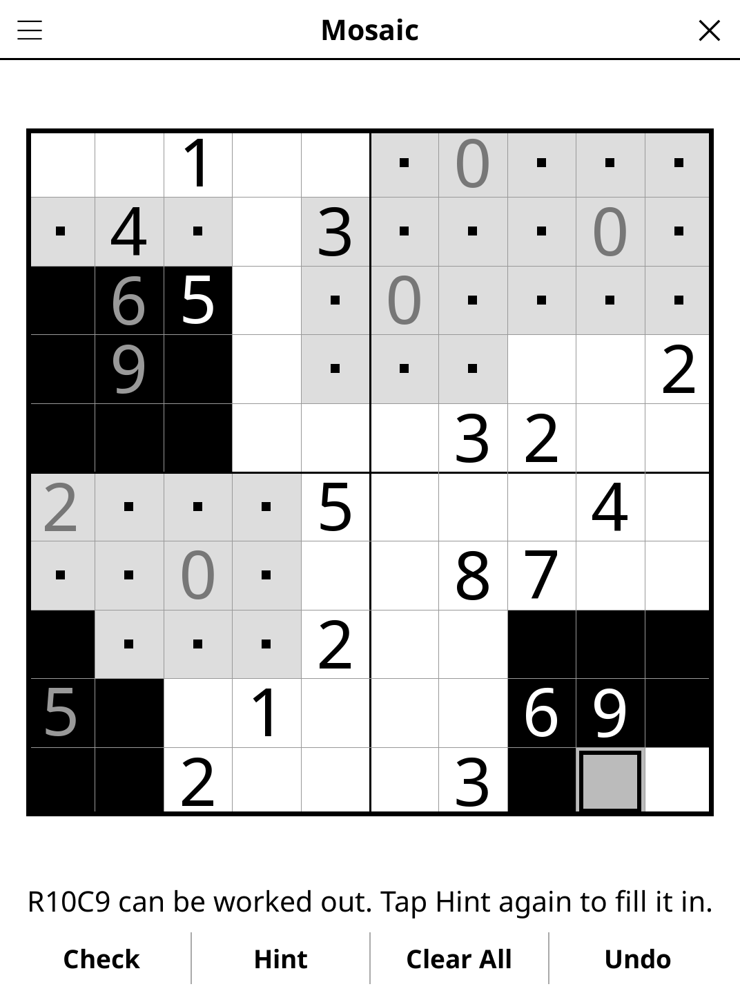

# mosaic.koplugin

A Mosaic (Fill-a-Pix) puzzle plugin for [KOReader](https://github.com/koreader/koreader).

## Screenshot

## Rules

Shade cells so that every number is right: a number tells how many cells are
shaded in its 3×3 block (the cell itself and its up to eight neighbours).
The shaded cells form a picture.

## Features

- **Four sizes** — 8×8, 10×10, 12×12, 15×15
- **Three difficulty levels** — every puzzle has exactly one solution, proven
  by a logical solver at generation. Easy is solvable one clue at a time;
  Medium needs reasoning on two overlapping clues somewhere; Hard has fewer
  starting points and needs that pair reasoning repeatedly.
- **Live clue feedback** — a number turns grey once its block is complete and
  correct, and is framed when its block can no longer be right
- **Hint** — two taps: the first points at the simplest cell the logic can
  decide from your current marks (or at a wrong cell), the second fills it
- **Check**, **Undo**, **Clear All**, timer, auto-save

## How the puzzles are made

A random blob picture gets a clue in every cell; clues are then removed one
at a time, in random order, each removal kept only if the graded solver still
finishes at the chosen difficulty. Over 150 seeds on a desktop (LuaJIT),
15×15 takes about 0.04 s on average and at most about 0.13 s (hard). A
progress bar appears if generation runs longer than a fraction of a second
(an e-reader is 5–10× slower). Generation depends only on the random seed,
never the clock, so the Daily Challenge is the same grid on every device.

## Installation

1. Download `mosaic.koplugin.zip` from the [latest release](../../releases/latest).
2. Extract into the `plugins/` folder of your KOReader data directory.
3. Restart KOReader.
4. Open the menu → **Tools** → **Mosaic**.

## Controls

| Action | How |
|--------|-----|
| Shade / mark empty / clear | Tap a cell (cycles through the three) |
| Mark empty directly | Hold a cell |
| Check progress | Tap **Check** |
| New puzzle, size, difficulty, rules | Title-bar menu |

## License

GPL-3.0 — see [LICENSE](LICENSE).
